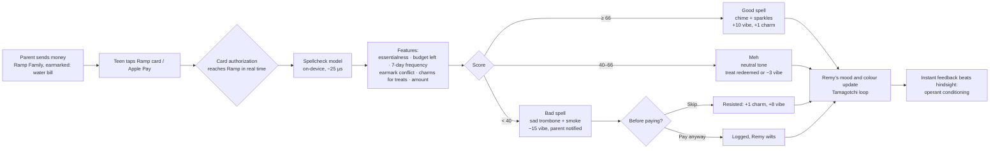

# Spellbound in Figma

Finished screens and a presentation board are in `mockups/` (`spellbound-board.png`). Drop them into Figma as a visual reference, or import live layers as below.

Three parts, one Figma file:
1. **Screens**: the real app imported as editable layers (most accurate).
2. **Prototype**: screens wired together with Smart Animate.
3. **Workflow**: the system diagram in FigJam.

Base URL for every link below:
`https://raw.githack.com/emill-y/WhatsInMyBag/67d55a528d7f8cef5e9106c2708a1709df3d3ce6/spellbound/index.html`

---

## 1. Screens: import the real app (html.to.design)

1. In Figma: Resources → Plugins → search **html.to.design** (by ‹div›RIOTS) → Run.
2. Paste a link from the table, set the viewport to **iPhone 14/15 (390 × 844)**, and turn on **Auto layout** and **Create local styles** if offered.
3. Import. Repeat for each screen. Each `#shot=` link renders the screen frozen at its final frame, with no sound and no saved data.

| Frame name | Link (base URL + this) | What it shows |
|---|---|---|
| 01 Home | `#shot=home` | Remy thriving, balance, Mom's $275 set aside, budgets |
| 02 Home · wilting | `#shot=home-sad` | Low vibe, Remy grey and frowning |
| 03 Choose purchase | `#shot=sheet` | Bottom sheet: before/after toggle, purchases, custom entry |
| 04 Notification | `#shot=notif` | "Hold up · DoorDash, $32.40" banner |
| 05 Casting | `#shot=cast` | Wand with card, sparkles |
| 06 Good spell | `#shot=good` | Groceries, lime, sparkles, Remy overjoyed |
| 07 Good · on purpose | `#shot=purpose` | Water bill: "Exactly what Mom sent it for" |
| 08 Bad spell | `#shot=bad` | 3rd matcha this week, smoke, Remy sad |
| 09 Bad · earmark | `#shot=earmark` | $275 clothes cart: "That's Mom's money for the water bill" |
| 10 Earned it | `#shot=treat` | Charms earned make a matcha okay |
| 11 Meh | `#shot=meh` | Sushi dinner, neutral |
| 12 Just paid | `#shot=paid` | Apple Pay matcha, after the fact |

After importing:
- Turn the gecko into a **component with a Mood variant** (happy, joy, meh, sad, cry), using the layers from frames 01, 06, 11, 08 and 09. Turn the verdict screen into a component with a **Verdict variant** (good, meh, bad).
- Check the colour styles match the tokens below, and rename any the plugin made.

## 2. Prototype

Wire the frames in Prototype mode:
- 01 → tap "Cast before you pay" → 03 (Move in from bottom, 380 ms, ease out)
- 03 → tap a row → 05 (Dissolve 200 ms) → **After delay 1100 ms** → 06, 08 or 10 (Smart Animate 450 ms)
- 08 → "Skip it" → 01 · 08 → "Pay anyway" → 02
- 04 → tap banner → 05
- 12 is where the Apple Pay notification lands

For the bad screens, add a short shake: duplicate the frame, nudge it 8 px, and Smart Animate between the two at 60 ms.

---

## Design tokens (match these)

| Token | Value | Use |
|---|---|---|
| ink | `#0B0B0A` | Text, primary buttons, bad-verdict background |
| paper | `#FFFFFF` | Cards |
| bg | `#F4F3EE` | App background, meh-verdict background |
| line | `#E4E2DA` | 1 px hairlines |
| muted | `#74736C` | Secondary text |
| lime | `#D4F53C` | Accent, good-verdict background, buttons on ink |
| lime-deep | `#A9CC12` | Good dot, gecko shading |
| gecko | `#C8EE2A` / `#9DC40F` / `#EAFBA4` | Body / shading / belly, thriving |
| gecko · wilted | `#A3AD80` / `#7C8460` / `#D3D6BF` | Bad verdict, low vibe |

**Type:** Inter for UI (600 for numbers, tabular figures, −3.5% tracking on big amounts) and Instrument Serif Italic for the verdict words ("Good spell.").
**Shape:** 16 px cards, a 24 px pet stage, pill buttons 56 px tall, 16 px side margins.
**Effects:** flat fills only; no drop shadows.

**Ramp brand:** Ramp's own site uses black and white with a single yellow-green accent, lots of white space, big confident numbers and a grotesk sans. If your team has access to Ramp's real typeface and brand colours, swap them in for the font and `lime` styles. Everything else follows those styles.

---

## 3. Alternative: generate it with Figma Make

If you'd rather have Figma's AI build an interactive prototype from scratch, paste this into **Figma Make**:

```
Build a mobile app prototype (iPhone, 390×844) called "Spellbound", a Ramp Family concept: instant, gamified feedback on a purchase right before or right after you pay, for teens spending money a parent sent.

STYLE: minimal fintech, in the style of Ramp. Off-white background #F4F3EE, white cards #FFFFFF with 1px hairlines #E4E2DA and 16px radius, near-black #0B0B0A text and primary buttons, ONE accent colour: lime #D4F53C. Inter for all UI (big numbers 600 weight, tight tracking, tabular figures); Instrument Serif Italic only for the verdict headline. Pill buttons 56px tall. Flat fills, no shadows, no gradients. Lots of white space. Whimsical but restrained.

MASCOT: "Remy", a gecko drawn like Asana's celebration creatures: seen side-on facing right, one clean silhouette with NO outlines, built from flat planes of a single lime: base #C8EE2A, shade #9DC40F (the back and the near legs), deep shade #86A80C (the far legs, spots), light #EAFBA4 (belly and jaw). Big rounded head on a short rising neck, a long body, a tail that curls into a spiral, bent legs with three soft splayed toes, a few small spots on the back. The face is tiny and simple: one round black eye with a white glint, a single-line mouth. Moods: happy (standing, gentle smile), joy (leaping up and to the right, legs stretched, ^-shaped closed eye, open grin, with a three-band motion streak behind him in white, shade lime and ink that fades out — like the Asana trails), meh (standing, head tipped down slightly, half-closed eye, flat mouth), sad (head dropped, tail lowered, worried brow above the eye, frown, colours fade to dusty olive #A3AD80 / #7C8460 / #D3D6BF), cry (sad + one blue tear).

SCREENS:
1. Home: header "Spellbound" with a small star-wand logo and "Ramp Family". Black rounded card (24px radius) with Remy in the middle, name "Remy" in serif, "Lvl 3" lime pill, and three stats: Vibe 74 (lime progress bar), Charms 0, Streak 0. Below: white card "Available to spend $412.18" (cents in grey) and a row "Mom sent you money · For the water bill · set aside · $275" with a lime water-drop icon. One full-width black button "Cast before you pay" with a lime wand icon, and under it a quiet text link "Already paid? Log it". Budgets show the 4 most at-risk categories plus "Show all 9"; rows use thin line icons per category, not letters. Then "Budgets this month" rows (Groceries $188 of $400 left, Bills, Transport, Eating out, Delivery, Coffee & treats, Clothing, Fun) with thin progress bars, and "Recent spells" rows with a coloured dot for good/meh/bad.
2. Choose purchase: bottom sheet, segmented control "Before I pay | I just paid", transaction-style rows (Weekly groceries $64.20, Water bill $275, Iced oat matcha $7.25, Another hoodie $68, Cart · 6 clothing items $275, Gas $42.10, Dinner with friends $38.40, Concert tickets $140), plus merchant and amount inputs and a "Cast spell" button.
3. Casting: full black screen, a star-shaped wand with a credit card inside the star, waving, a thin pulsing ring, lime and white sparkles, serif italic "Casting…", and small grey steps text "Checking your budgets".
4. Good spell: full lime screen. Small uppercase row "BEFORE YOU PAY" left, "✦ SPELLCHECK" right. "Weekly groceries · Greenleaf Market" and "$64.20" (36px). Remy in joy mood fills the middle, with black and white four-point sparkles in a ring around him, never over text. Serif italic "Good spell." (56px) and "Feeding future you. Remy approves." Then one rounded "Why" card: "Why" left, "96/100" right; a track split into three zones Bad 40% / Meh 26% / Good 34% with the verdict's zone filled and a round knob at the score; reasons as a list with circled + or − icons ("Essential · groceries", "$124 left in groceries"), only the ones that agree with the verdict; caption "Scored on your phone in 24 µs". Black "Pay $64.20" button directly under the card.
5. Meh: off-white screen, Remy in meh mood (half-closed eyes), the same layout with a white Why card. Variant "Earned it." + "Treat unlocked — you earned this one with good spells." when charms make a treat okay; plain "Hmm. Meh." otherwise. Buttons "Pay $7.25" (black) and "Skip it" (outline).
6. Bad spell: full black screen with soft, blurred grey smoke around Remy, who is wilted grey-green with worried brows (raised in the middle, not angry) and tears. "Bad spell.", "That’s Mom’s money for the water bill." Dark Why card with "1/100", knob in the Bad zone, reasons "− Uses $138 of Mom’s water bill money", "− Over clothing budget by $269". Buttons lime "Skip it · +1 charm" and outlined "Pay anyway".
7. iOS-style notification banner at the top of the home screen: "SPELLBOUND · now / Hold up · DoorDash, $32.40 / Remy has thoughts. Tap before you pay."

INTERACTIONS: Cast button opens the sheet; tapping a row plays Casting for 1.1s, then shows the verdict; Skip/Pay return home with Vibe, Charms and Streak updated and Remy reacting; tapping the notification goes to Casting.
```

## 4. Workflow (FigJam)

Paste this into **FigJam AI** (⌘ Shift A → "Generate diagram"), or into a Mermaid-to-FigJam plugin:


